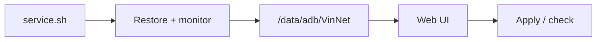

 
 

<h1>VinNet</h1>

<b>Simple Implementation of Network Optimization</b>

Root-level network control for Android — live tweak state, per-interface QDISC, and opt-in restoration.

  
  
  
  

  
  

  <a href="#overview">Overview</a> ·
  <a href="#tweaks">Tweaks</a> ·
  <a href="#compatibility">Compatibility</a> ·
  <a href="#install">Install</a> ·
  <a href="#diagnostics">Diagnostics</a> ·
  <a href="changelog.md">Changelog</a>

---

## Overview

VinNet exposes a small set of network controls instead of applying a hidden profile. Every value is checked live, QDISC is configured per interface, and restoration is optional.

- **Live state** — unsupported controls are disabled; unknown states show an indeterminate switch.
- **24 QDISC disciplines** — apply to all eligible interfaces or one interface at a time; `Custom` appears when interfaces differ.
- **Opt-in restoration** — Persistent Tweaks re-applies reset-prone tweaks after boot and during Web UI checks.

## Tweaks

| Tweak | What it changes | Reset behavior |
| :-- | :-- | :-- |
| **IP Reach Disconnect** | Prevents Wi-Fi from dropping when the network becomes unstable. | After reboot |
| **QDISC** | Choose one of 24 queue disciplines for all eligible interfaces or one interface; `Custom` appears when interfaces differ. | After reboot |
| **Wi-Fi Force Low Latency Mode** | Forces Android's low-latency mode, with hi-perf fallback. | After interface changes |
| **Network Avoid Bad Wi-Fi & Mobile Data Always ON** | Keeps Wi-Fi connected as signal degrades and stops background cellular data from disrupting transmission. | Persists |
| **BLE Scan Always Enabled** | Reduces jitter and ping spikes on 2.4 GHz Wi-Fi. | Persists |
| **Wi-Fi Scan Throttle** | Limits background Wi-Fi scanning to reduce jitter and save battery. | Persists |

> [!NOTE]
> Persistent Tweaks is off by default. When enabled in Settings, it restores `IP Reach Disconnect`, `QDISC`, and `Wi-Fi Force Low Latency Mode` after boot and during Web UI checks. `Tweaks.json` stores desired values only; displayed status always comes from live reads.

## Compatibility

VinNet uses the standard Magisk module format and Android shell tools. It ships no native binaries, so there is no ABI-specific build.

| Environment | Module support | Web UI |
| :-- | :--: | :-- |
| **Magisk** | Supported | Requires a Web UI-capable host |
| **KernelSU** | Supported | Module screen |
| **APatch** | Supported | Module screen |

- On `fog`, the installer adds vendor Wi-Fi config; other devices keep stock vendor files.
- KernelSU/APatch forks on the standard module format should work but are not individually tested. APatch itself targets ARM64.

## Install

Requires a rooted Android device and a supported module manager.

1. Download the latest `VinNet-*.zip` from [<ins>Releases</ins>](https://github.com/Vinzz1234567890/VinNet/releases).
2. Open your root manager → **Modules** → **Install from storage**.
3. Select the zip and flash it.
4. Reboot.
5. Open the Web UI. Enable **Persistent Tweaks** in Settings if you want reset-prone tweaks restored after boot and during checks.

> [!IMPORTANT]
> Remove conflicting network-tuning modules first. Two modules writing the same `tc`, `settings`, or `resetprop` values will make live state misleading.

## How it works

`service.sh` waits for boot, restores Persistent Tweaks when enabled, writes runtime JSON to `/data/adb/VinNet`, and monitors latency while the Web UI is active. The Web UI delegates apply, check, and QDISC probe operations back to the same service script.

## Diagnostics

One log: **`/storage/emulated/0/Download/VinNet.log`**. It records device/kernel/ABI, module version, tool paths, core writability, filtered Wi-Fi state, and tweak or Web UI failures. The service truncates it at 128 KiB on startup.

> [!TIP]
> When reporting a bug, include the log, root manager/version, device/ROM, and tweak name. For QDISC, include the interface and discipline.

## Safety

> [!WARNING]
> Root access can break things. VinNet changes network settings and kernel queue disciplines; use it at your own risk. Tweaks are opt-in, and some reset after reboot or interface changes. Do not stack conflicting network modules. VinNet is not affiliated with Google, Android, Magisk, KernelSU, or APatch.

## Community

- **Repository:** [Vinzz1234567890/VinNet](https://github.com/Vinzz1234567890/VinNet)
- **Telegram:** [Vinzz Repository](https://t.me/VinzzRepository)
- **Feedback:** [@Vinzz1234567890](https://t.me/Vinzz1234567890)

## License

Licensed under the [<ins>Apache License 2.0</ins>](LICENSE).

Measure the network. Change only what you mean to.

 
 

Built by <a href="https://github.com/Vinzz1234567890">Vinzz</a> · Apache-2.0

