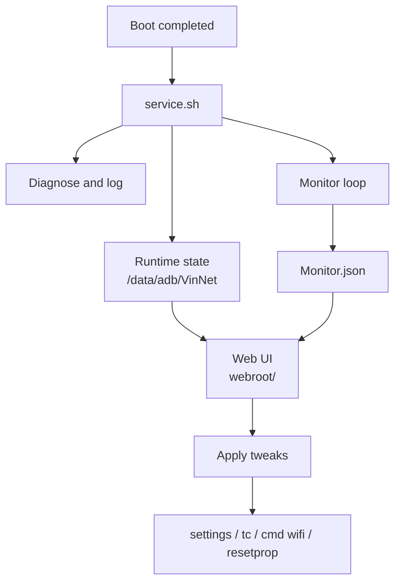

 
 

<h1>VinNet</h1>

<b>Simple Implementation of Network Optimization</b>

A root-level network control room for Android — live tweak state, per-interface QDISC, and diagnostics that show what actually changed.

  
  
  
  

  
  
  

  <a href="#why-vinnet">Why VinNet</a> ·
  <a href="#tweaks">Tweaks</a> ·
  <a href="#compatibility">Compatibility</a> ·
  <a href="#install">Install</a> ·
  <a href="#how-it-works">How it works</a> ·
  <a href="#diagnostics">Diagnostics</a> ·
  <a href="changelog.md">Changelog</a>

---

## Why VinNet

VinNet is not a profile pack and it is not a fire-and-forget optimizer. It exposes a small set of network controls, reads their real state from the device, and tells you when it cannot.

| Principle | What it means |
| :-- | :-- |
| **Live, not remembered** | Every tweak is checked against the device on load. Unsupported controls are disabled; an unreadable state shows an indeterminate switch instead of a stale saved value. |
| **Per-interface QDISC** | Pick one of 19 queue disciplines for all eligible interfaces or target a single interface. A `Custom` state appears when interfaces disagree. |
| **Opt-in by design** | VinNet does not re-apply tweaks at boot. You choose what to change in the Web UI, and the service logs what it sees. |

## Tweaks

Six focused controls. No bundled profiles, no automatic profile switching — apply only what your device supports.

| Tweak | What it changes | Reset behavior |
| :-- | :-- | :-- |
| **IP Reach Disconnect** | Prevents Wi-Fi from suddenly disconnecting when the network becomes unstable. | After reboot |
| **QDISC** | Choose one of 19 queue disciplines for all eligible interfaces or a single interface. A `Custom` state appears when interfaces disagree. | After reboot |
| **Wi-Fi Force Low Latency Mode** | Forces Android's built-in low-latency mode, falling back to hi-perf mode on devices that lack it. | After interface changes |
| **Network Avoid Bad Wi-Fi & Mobile Data Always ON** | Keeps Wi-Fi connected as signal quality degrades and stops background cellular data from disrupting transmission. Both settings are toggled together. | Persists |
| **BLE Scan Always Enabled** | Reduces jitter and ping spikes when gaming over a 2.4 GHz Wi-Fi network. | Persists |
| **Wi-Fi Scan Throttle** | Limits background Wi-Fi scanning to reduce jitter and save battery. | Persists |

> [!NOTE]
> The Web UI reads live state on every load. Unsupported tweaks are disabled, and unknown states show an indeterminate switch. There is no saved tweak-state file to mistake for the current value.

## Compatibility

VinNet uses the standard Magisk module format and Android shell tools. It ships no native binaries, so there is no ABI-specific build.

| Environment | Module support | Web UI |
| :-- | :--: | :-- |
| **Magisk** | Supported | Requires a Web UI-capable module host |
| **KernelSU** | Supported | Available from the module screen |
| **APatch** | Supported | Available from the module screen |

> [!NOTE]
> The Web UI is served from `webroot/`. If your manager does not expose a module Web UI, use a Web UI-capable host or run the same commands through a root shell.

<b>Community forks and device-specific vendor configuration</b>

 

VinNet is built on the standard Magisk module format. Forks such as KernelSU Next, KowSU, Wild_KSU, RKSU, MamboSU, SukiSU-Ultra, ReSukiSU, and APatch/FolkPatch are expected to work when they support standard module scripts and `resetprop`. They are not individually tested by this repository.

On `fog` devices, `customize.sh` installs the bundled vendor Wi-Fi configuration. On other devices, `system/vendor` is removed during installation, leaving stock vendor files untouched.

APatch itself currently targets ARM64 devices. VinNet ships no native binaries, so this is an APatch platform requirement rather than a VinNet build variant.

## Install

Requires a rooted Android device and a supported module manager.

1. Download the latest `VinNet-*.zip` from [<ins>Releases</ins>](https://github.com/Vinzz1234567890/VinNet/releases).
2. Open your root manager → **Modules** → **Install from storage**.
3. Select the zip and flash it.
4. Reboot.
5. Open the module Web UI and apply only the tweaks you need. QDISC and some Wi-Fi tweaks reset after reboot or interface changes.

> [!IMPORTANT]
> Remove conflicting network-tuning modules first. Two modules writing the same `tc`, `settings`, or `resetprop` values will make live state misleading.

## How it works

VinNet keeps the moving parts small: a boot service, a runtime state directory, and a Web UI that reads through the root manager.

| Path | Purpose |
| :-- | :-- |
| `META-INF/` | Flashable module metadata |
| `system/vendor/etc/wifi/` | Bundled vendor configuration (`fog` only) |
| `webroot/` | Web UI: HTML, CSS, JS, fonts, and banners |
| `customize.sh` | Install report and vendor config selection |
| `service.sh` | Boot service, diagnostics, and monitor loop |
| `uninstall.sh` | Runtime and property cleanup |
| `module.prop` | Module identity and update manifest |
| `update.json` | Update manifest for root managers |

<b>Runtime files written to <code>/data/adb/VinNet</code></b>

 

| File | Purpose |
| :-- | :-- |
| `ProcessID.json` | Current service PID and timestamp; also touched by the Web UI to signal activity. |
| `Metadata.json` | Module identity and version. |
| `Environment.json` | Brand, model, Android, kernel, ABI, and root manager. |
| `Monitor.json` | Latest latency and jitter samples. |
| `.Diagnose.tmp` | Buffered diagnostic block before it is flushed to the log. |

No tweak-state file is written. The Web UI reads live values every time it loads, so a tweak that resets after reboot shows as reset.

## Diagnostics

VinNet writes one log:

**`/storage/emulated/0/Download/VinNet.log`**

It includes:

- device brand/model, Android, kernel, and ABI
- module version and resolved tool paths
- `/data/adb/VinNet` writability plus relevant mount and dmesg lines
- filtered `dumpsys wifi` state (`Wi-Fi is`, `ClientModeImpl`, `curState`, `Supplicant state`, `mPowerSaveDisableRequests`)
- tweak check and apply failures
- Web UI errors, rejected promises, and failed JSON, image, command, and link operations

The service truncates the log at 128 KiB on startup.

> [!TIP]
> When reporting a bug, include your root manager and version, device/ROM/Android/kernel, the tweak name, and the relevant log excerpt. For QDISC, also include the interface name and chosen discipline.

## Latest release

**1.2.2-Fless** focuses on control and visibility:

- QDISC is now a 19-discipline selector with per-interface chips and a `Custom` state.
- Tweak status is live-checked; unsupported controls are disabled and unknown states are indeterminate.
- Network Avoid Bad Wi-Fi and Mobile Data Always ON are combined into one toggle.
- Diagnostics include device, kernel, module, and Wi-Fi context; logs use full timestamps and capture more failures.

[Read the full changelog →](changelog.md)

## Safety

> [!WARNING]
> Root access can break things. VinNet changes network settings and kernel queue disciplines; use it at your own risk. Tweaks are opt-in, and some reset after reboot or interface changes. Do not stack conflicting network modules. VinNet is not affiliated with Google, Android, Magisk, KernelSU, or APatch.

## Community

- **Repository:** [Vinzz1234567890/VinNet](https://github.com/Vinzz1234567890/VinNet)
- **Telegram:** [Vinzz Repository](https://t.me/VinzzRepository)
- **Feedback:** [@Vinzz1234567890](https://t.me/Vinzz1234567890)
- **Issues:** [GitHub Issues](https://github.com/Vinzz1234567890/VinNet/issues)

<b>Artwork</b>

 

<table>
  <tr>
    <td></td>
    <td></td>
    <td></td>
  </tr>
</table>

## License

Licensed under the [<ins>Apache License 2.0</ins>](LICENSE).

Measure the network. Change only what you mean to.

 
 

Built by <a href="https://github.com/Vinzz1234567890">Vinzz</a> · Apache-2.0

